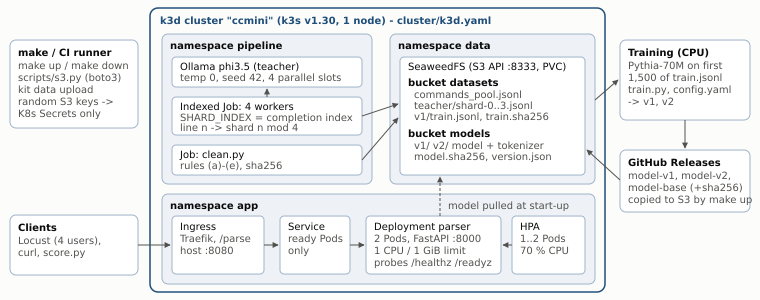
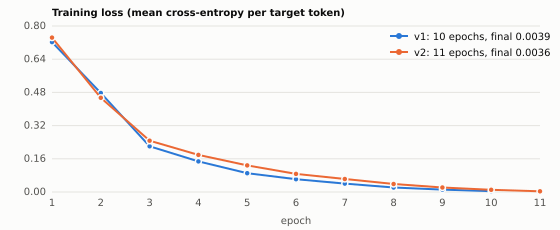

<h1>Knowledge Distillation and Deployment of a Command-Parsing Model on a Local Cloud</h1>

<b>Name:</b> ⟨NAME⟩ &nbsp;·&nbsp; <b>Roll number:</b> ⟨ROLL⟩ &nbsp;·&nbsp; CS3081 Cloud Computing mini project &nbsp;·&nbsp;
<b>Repository:</b> <a href="https://github.com/kumshivam0712/cloudcomputing">github.com/kumshivam0712/cloudcomputing</a> (tag <code>final</code>)

<b>Reading guide.</b> Green = measured (copied from a file in <code>results/</code>, produced by a script or workflow run); amber = assumption or design choice. All runs used GitHub-hosted runners (Ubuntu 24.04, 4 vCPU, 16 GB RAM, no GPU) as the "laptop": every task ran on one such machine inside a k3d cluster created from <code>cluster/k3d.yaml</code>.

## Architecture

<figure><figcaption>One k3d cluster, three namespaces. Data flows: kit → <code>s3://datasets</code> → teacher workers → shards → <code>clean.py</code> → <code>train.jsonl</code> → CPU training → GitHub Releases → <code>s3://models</code> → service Pods (model pulled at start-up) → Traefik Ingress → clients.</figcaption></figure>

Object storage is the hand-off point between every stage, and every hand-off is checksummed (`train.sha256`, `model.sha256`). The GitHub Release is the durable copy of the model; SeaweedFS is the copy the cluster reads at runtime, so a fresh clone can rebuild the whole system without retraining.

## 1 · Object storage and parallel teacher labelling

**Architecture / implementation.** `k3d cluster create --config cluster/k3d.yaml` (k3s v1.30.6, one server node; host port 8080 → Traefik, 8333 → SeaweedFS NodePort). **SeaweedFS 3.80** runs in namespace `data` as one all-in-one Pod (master, volume, filer, S3 gateway) on a 5 Gi local-path PVC; its S3 identities file is mounted from a Secret generated at deploy time with random keys (`scripts/secrets.sh`; nothing secret in Git). `make storage` creates the buckets **`datasets`** and **`models`** (boto3) and uploads `commands_pool.jsonl` to `s3://datasets/commands_pool.jsonl`. The **teacher** (`ollama/ollama:0.5.7`, model `phi3.5:latest`, Ollama ID 61819fb370a3, 3.8 B parameters, Q4_0, 2.2 GB) runs *inside* the cluster in namespace `pipeline` with 4 decoding slots; every request uses temperature 0, seed 42 (and `num_predict` 128 as a length cap). The prompt (`prompts/teacher_prompt.txt`) states the task, lists the eight intents with the handout's examples, defines the three slots and the three copy rules, gives nine worked examples (none taken from `validation.jsonl`), and asks for one line of JSON only. **Workers** (`worker/worker.py`, image built by `worker/Dockerfile`) write `{"id","text","teacher_raw"}` lines - `teacher_raw` is Ollama's `response` field, stored unchanged. **`worker/clean.py`** runs as a Job in the cluster, reads all shard objects, applies the rules in the order (a) invalid JSON → (b) keys ≠ {intent, date, time, place} → (c) intent not one of eight → (d) a slot that is neither null nor a non-empty string occurring in the command (case/space-insensitive) → (e) duplicate command (lower-cased, spaces collapsed; resolved *after* (a)-(d) so the smallest-id **valid** copy is kept), and writes the survivors in id order to `s3://datasets/v1/train.jsonl` with `train.sha256` (each line keeps the teacher's four values and its exact raw reply).

**Results** (measured, workflow run 42500739339; `results/task1/`). Four worker Pods (SHARD_INDEX 0-3) started together at 16:48:17 and finished between 19:56:51 and 20:00:53 UTC (`pipeline.txt`) - 750 commands each, **3 h 08 min - 3 h 13 min**, i.e. 15.2 s per command per worker and **3.8 s per command overall** (~790 commands/h) on 4 CPU cores. Coverage check: 3,000 ids, 0 missing, 0 repeated. The buckets and objects are listed in `storage.txt`.

| Input records | (a) invalid JSON | (b) wrong keys | (c) bad intent | (d) bad slot | (e) duplicates | **Kept** |
|---:|---:|---:|---:|---:|---:|---:|
| 3,000 | 157 | 1 | 3 | 138 | 40 | **2,661** |

3,000 = 157 + 1 + 3 + 138 + 40 + 2,661. `train.sha256` = `b79246c9…aea35`; running `clean.py` again on the downloaded shard files reproduces it exactly (`verify_checksum.txt`). Typical rejects: (a) a correct object *followed by* an unrequested "Note: …" explanation; (d) rewritten slots ("after two days" → "in two days", "emma's" → "emmas"); (c) `"intent": null` for commands outside the eight intents. The training set uses the first 1,500 kept records.

**Limitations.** The CPU-only teacher dominates the cost (3 h for 3,000 short commands); one Ollama replica is both the bottleneck and a single point of failure; static sharding cannot rebalance stragglers (4-minute spread). Temperature 0 + seed 42 is *not* bit-for-bit reproducible across runs with concurrent batching: the same 100 validation commands scored 94 % and 95 % JSON validity in two runs. **Improvements:** constrain decoding (Ollama `format` JSON schema or a stop sequence) to remove the "Note" tails (≈5 % of the data lost), a work queue instead of static shards, a GPU node or several teacher replicas.

**Sharding (design).** A worker with `SHARD_INDEX=i`, `SHARD_COUNT=K` takes the pool lines *n* with *n* mod *K* = *i* (striping), so the shards are disjoint and together cover every line - no coordination, locks or queue are needed, and each worker writes only its own object `datasets/teacher/shard-i.jsonl`, so there is no write contention in S3 (objects cannot be appended to safely by two writers). Striping (instead of contiguous blocks) spreads the duplicates and intents evenly and gives every worker the same amount of work (750 lines each for K = 4). The workers are one Kubernetes **Indexed Job** (`completions = parallelism = K`), and `SHARD_INDEX` is read from the Pod's completion-index annotation through the downward API, so a Pod that is restarted keeps its index. Each worker re-uploads its object every 25 records and skips ids already present when it starts, so a restart neither loses nor repeats work. K = 4 matches `OLLAMA_NUM_PARALLEL=4` decoding slots in the single CPU-bound teacher: more workers than slots would only queue. `clean.py` checks coverage (no id missing, repeated or unknown) before writing the training set.

## 2 · Training the student (sequence-level distillation)

**Implementation.** `make train` creates a pinned CPU environment and runs `training/train.py --config training/config.yaml`, which reads *only* that file: **seed 42, learning rate 5e-4, batch size 16, 10 epochs, max sequence length 128**, libraries python 3.12 / torch 2.5.1 / transformers 4.46.3 / tokenizers 0.20.3 (checked against the installed versions at start-up), plus AdamW (weight decay 0.01), 6 % linear warm-up then linear decay, gradient clipping 1.0. The base model is `EleutherAI/pythia-70m` pinned to revision `a39f36b`. Each example is `Command: <text>\nJSON: <teacher reply><|endoftext|>`; the loss is computed on the reply tokens only (the prompt is masked), so the model learns *to answer*, not to repeat commands. The first 1,500 records of `train.jsonl` are used (58,828 tokens, none truncated). The seed fixes Python, NumPy and PyTorch RNGs and the shuffling generator; one loss row per epoch goes to `training/loss.csv`. `make train SUBSET=50` ran to the end in CI (10 epochs × 5 s, `results/task2/train_subset50.log`). **v2** (`config_v2.yaml`) changes only the seed (1234) and adds one epoch. Model + tokenizer + `version.json` are saved to `build/models/v<k>/`, `scripts/model_checksum.py` writes `model.sha256` (sha256sum format), the files are published as GitHub Releases `model-v1`, `model-v2` (and `model-base`, the untrained model) and `make up` copies them to `s3://models/v1/` and `s3://models/v2/` (listing: `results/task4/models_bucket.txt`). The downloaded `model-v1` Release assets pass `sha256sum -c models/v1/model.sha256` (`results/task2/release_checksum_check.txt`); `model.safetensors` = `fb244137…3269`.

<figure><figcaption>Training loss per epoch (<code>training/loss.csv</code>, <code>training/loss_v2.csv</code>); ~155 s per epoch for v1, 25.7 min in total on 4 CPU cores.</figcaption></figure>

**Results on `validation.jsonl`** (measured with the kit's `score.py`, final generation code, workflow run 42524318612; raw outputs and reports: `results/teacher_validation*`, `results/pythia_base_*`, `results/student_v1_*`, `results/student_v2_*`; `results/teacher_validation.json` is the teacher's report):

| Model | JSON validity | Intent | Date | Time | Place | **Full frame** |
|---|---:|---:|---:|---:|---:|---:|
| Teacher phi3.5 ¹ | 95.0 | 83.0 | 81.0 | 81.0 | 87.0 | **53.0** |
| Pythia-70M untrained | 0.0 | 0.0 | 0.0 | 0.0 | 0.0 | **0.0** |
| **Student v1** (10 epochs) | **100.0** | 87.0 | 86.0 | 83.0 | 84.0 | **47.0** |
| Student v2 (seed 1234, 11 ep.) | 100.0 | 83.0 | 82.0 | 85.0 | 86.0 | **49.0** |

¹ 3.8 B parameters via Ollama, same prompt and settings as Task 1. Students: Pythia-70M distilled.

**What changed.** The untrained Pythia-70M has never seen the format: its first generated token is a newline, so every answer is empty (0 % on everything). After distillation the 70 M student reaches **89 % of the teacher's full-frame accuracy (47 vs 53)** with **~54× fewer parameters** and answers in 0.33 s (median, 4 threads) instead of several seconds. It is *more* often valid JSON than the teacher (greedy alone: 99 vs 95 %), because the cleaned training set contains no "Note: …" tails - the student copies the teacher's *filtered* behaviour, not its failures. In 64 of 100 commands the student's greedy object is identical to the teacher's; 42 commands are fully right for both, 11 only for the teacher, 5 only for the student. Its single invalid greedy output (V028, a corrupted slot string) is repaired by the beam-search retry into a *valid but wrong* object (`"time": "one"`), which raises validity to 100 % and intent/date to 87/86 % without changing full frame (greedy-only scores from the training run: 99/86/85/83/84/47, `results/task2/train_v1.log`). v2 is slightly better on full frame (49) and validity (100) but worse on intent (83); the differences (2-3 commands) are within run-to-run noise on 100 examples. **Suitability of Pythia-70M:** good at copying short spans (slot values) and learning a fixed output format, Apache-2.0, small enough for 1 CPU / 1 GiB; but it has little world knowledge, so it cannot generalise to intents or slot styles the teacher never produced, and it cannot follow instructions without fine-tuning.

**Sequence-level vs logit-based distillation.** *(a) Sequence-level KD* (Kim & Rush, 2016) trains the student with ordinary cross-entropy on the teacher's **generated output sequence** - here the teacher's greedy JSON reply - as if it were the gold label; the teacher's knowledge is passed only through which answer it chose. *(b) Logit-based (word-level) KD* (Hinton et al., 2015; TRL `GKDTrainer`/`DistillationTrainer`) trains the student to match the teacher's **full next-token probability distribution** at every position, usually by minimising the KL divergence between temperature-softened teacher and student distributions; it transfers "dark knowledge" (how plausible the teacher found the alternatives). *(c) Why it is not possible here:* the teacher is reached only through Ollama's text API, which returns the generated text, not the full-vocabulary logits at each step; and even with logits, phi3.5 (Llama-style SentencePiece vocabulary of 32,064 tokens) and Pythia-70M (GPT-NeoX BPE, 50,304 entries) tokenise text differently, so the two distributions are over different token sets and positions and cannot be compared term by term without an extra alignment method. *(d) A real limitation of what I did:* the student only ever sees the teacher's single answer, so it inherits the teacher's mistakes as if they were truth (the teacher itself is only 53 % full-frame correct on validation, and 1,500 examples is small), and it gets no signal about how confident the teacher was.

## 3 · Inference service in a container

**Architecture / implementation.** `service/app.py` (FastAPI 0.115.6 + Uvicorn, port 8000). On start-up a background thread lists `MODEL_URI` (e.g. `s3://models/v1/`) on `S3_ENDPOINT` with boto3, downloads every object to an `emptyDir`, verifies each file against the downloaded `model.sha256`, then loads model + tokenizer; failures are retried with back-off, never crash-looping. `GET /healthz` is always 200 while the process lives; `GET /readyz` is 503 until the model is loaded, then 200. `POST /parse` runs the same greedy generation code as evaluation (`service/model.py`, prompt `Command: …\nJSON:`, stop at newline/EOS, `MAX_NEW_TOKENS`), checks the text against `schema.json` (object, exactly the four keys, intent from the enum, slots string/null), and returns either the object alone (HTTP 200) or `{"error": "invalid_model_output"}` (HTTP 500) - never broken JSON with 200. *Retry (added after the first deployment run):* if the greedy answer fails the schema, the same model is asked once more with 4-beam search and the first beam that passes is used; otherwise the 500 stands (`FALLBACK_BEAMS`, default 4). Evaluation (`predict.py`) uses exactly the same code. Both headers `X-Model-Version` (= `MODEL_VERSION`) and `X-Served-By` (= Pod name, downward API) are set on every answer. `FAULT_INJECT=1` replaces the model output with `not json` *before* validation. Configuration: `MODEL_URI`, `MODEL_VERSION`, `S3_ENDPOINT`, `MAX_NEW_TOKENS` (+ `FAULT_INJECT`); S3 keys come only from the Secret `s3-credentials`. One generation runs at a time per Pod (lock; `TORCH_NUM_THREADS=1` to match the 1-CPU limit) while health checks stay responsive.

**Image.** `python:3.12.8-slim-bookworm`, CPU-only `torch==2.5.1+cpu` from the PyTorch CPU index (the default wheel pulls ~3 GB of CUDA libraries), every dependency pinned with `==` (fully resolved lock, `service/requirements.txt`), non-root user, no weights (checked: 0 weight files in the image). Build from a fresh clone with one command: `make image` (= `docker build -f service/Dockerfile -t ccmini/parser:1.0 .`).

**Results** (measured, deploy run 42524321276, `results/task3/`). Image `ccmini/parser:1.0`: **1,137,333,745 bytes (1.14 GB) ≤ 2 GB**; 0 weight files in the image, `/models` empty (`no_weights_in_image.txt`); all 40 installed packages match the `==` pins of `service/requirements.txt` (`pip_freeze_in_image.txt`). The container was started with `docker run --cpus=1 --memory=1g --memory-swap=1g` (cgroup `memory.max` = 1,073,741,824, `cpu.max` = 100000/100000). `/readyz` answered 503 until the model was loaded, then 200 (~5 s); `/healthz` 200 throughout. **50 sequential `POST /parse`: 50 × HTTP 200**, mean 422 ms, p50 402 ms, p95 469 ms, max 1,253 ms. **Peak memory: 656.1 MiB** (cgroup `memory.peak` = 688,001,024 bytes; it includes the page cache of the 282 MB weight file); `docker stats` sampled at ~1 Hz peaked at 379.8 MiB. **No OOM kill** (`OOMKilled=false`, `oom_kill 0`, 0 restarts). With `FAULT_INJECT=1`: `HTTP/1.1 500` with body exactly `{"error":"invalid_model_output"}` and both headers (`fault_inject.txt`).

**Limitations / improvements.** One generation at a time per Pod (≈ 2.4 requests/s per CPU); fp32 weights (282 MB) make up most of the memory. Dynamic int8 quantisation or ONNX Runtime would roughly halve both, and request batching would raise throughput. The beam-search retry hides a model error behind a *valid but wrong* answer (V028); a stricter design would return 500 and log it.

## 4 · Kubernetes deployment, scaling and reliability

**Architecture / implementation** (`k8s/app/parser.yaml`). Namespace `app`: a **Deployment** `parser` with 2 replicas, requests 500m CPU / 512 Mi and limits 1 CPU / 1 Gi, readiness probe `GET /readyz` every 2 s, liveness probe `GET /healthz` (10 s, 6 failures), rolling update `maxSurge 1 / maxUnavailable 0`, `preStop: sleep 8` and a 40 s grace period so that a Pod keeps serving while Traefik removes it from the endpoints; a **Service** (ClusterIP :80 → 8000) that only lists Ready Pods; a Traefik **Ingress** routing `/parse` (and `/readyz`, `/healthz`) from `localhost:8080`; an **HPA** `autoscaling/v2`, min 1, max 2, target 70 % average CPU utilisation (of the 500m request), scale-down stabilisation shortened to 60 s (default 300 s) so the demonstration fits in one CI run. All experiments are scripted in `scripts/experiments.sh` and ran in one `deploy` workflow run on a fresh runner; for the tests that need exactly two replicas (rolling update, recovery, load balancing, cold start) the HPA's `minReplicas` was temporarily patched to 2 and restored to 1 for the HPA test (design choice, recorded in the logs).

**Results** (measured, deploy run 42524321276, `results/task4/`):

| Check | Evidence |
|---|---|
| Ingress → Service → Pods | `curl -X POST localhost:8080/parse` → 200, four-key body, `X-Model-Version: v1`, `X-Served-By: parser-…-75tjb` (`parse_through_ingress.txt`) |
| Requests / limits | requests 500m / 512Mi, limits 1 CPU / 1Gi (`requests_limits.json`) |
| No ready endpoints while loading | cold-start run 1, 21:19:53-21:20:00: `ready endpoints: [] not-ready: [2 new Pods]`; the Ingress answered **404 for those 6 s** (no backend), 200 before and after (`coldstart/run1-watch.txt`, `run1-ingress-codes.txt`) |
| HPA 1 → 2 → 1 | idle → 1 replica (21:33:18); load started 21:33:26 → CPU 176 % of request → **2 replicas at 21:33:46 (20 s)**, peak 199 %; load stopped 21:38:26 → **back to 1 at 21:39:48** (82 s = 60 s stabilisation + metrics lag). Events: "New size: 2; reason: cpu resource utilization … above target", "New size: 1; reason: All metrics below target" (`hpa/`) |
| Rolling update under load | `set env MODEL_VERSION=v2 MODEL_URI=s3://models/v2/` at 21:23:35, rolled out in 19 s; `rollout undo` at 21:24:46, done in 20 s. Locust (6 min): **1,491 requests, 0 failed (0.00 %)**, 286 answered by v2. After rollback **10/10 responses `X-Model-Version: v1`** (`rolling/`) |
| Recovery under load | Pod deleted 21:29:36 → 2/2 Ready again 21:29:46 (**10 s**); Locust (3 min): **736 requests, 0 failed (0.00 %)** (`recovery/`) |
| Cold start ×3 | Pod creation → Ready: run 1: 8, 8 s; run 2: 9, 8 s; run 3: 9, 9 s → **median 9 s** (slowest Pod per run; 8.5 s over all 6 Pods). Logs: `downloaded 8 files (285.3 MB) from s3://models/v1/ in 1.4s`, `sha256 verified`, `model v1 loaded … in 2.6s` (`coldstart/`) |
| Load balancing (2 Ready replicas, standard command) | successful requests per replica: **268 / 265 = 50.3 % / 49.7 %** (`loadbalance_headers.json`) |

The *first* deployment run (greedy decoding only, `results/archive/greedy-only-run-42521715011/`) already lost **no** request to the rolling update, the Pod deletion or the scaling (0 connection errors / 502 / 503), but ~1 % of all requests were HTTP 500 for one validation command (V028), giving 0.86 % failures in the rolling update. The retry described in Section 3 removed exactly those failures.

**Limitations.** **The whole cluster is one k3s node on one machine:** these tests show that Kubernetes replaces Pods and shifts traffic, *not* fault tolerance across machines - losing the machine (or the single SeaweedFS Pod and its local-path volume) stops everything. The HPA can only go to 2 replicas on 4 cores; the experiments that need exactly two replicas temporarily set the HPA's `minReplicas` to 2 (logged). **Improvements:** several nodes with Pod anti-affinity and a PodDisruptionBudget, replicated object storage, a startup probe and a node-local model cache to cut cold start.

## 5 · Subnetting and network access control

**Subnets** (largest first from 10.20.0.0, each right after the previous, smallest prefix with 232−p − 2 ≥ hosts; full working in `network/subnets.md`, re-checked by `scripts/subnets.py` and a unit test):

| Subnet | Hosts needed | Network / prefix | Usable host range | Broadcast | Usable hosts |
|---|---:|---|---|---|---:|
| app | 1,000 | 10.20.0.0/22 | 10.20.0.1 - 10.20.3.254 | 10.20.3.255 | 1,022 |
| public | 250 | 10.20.4.0/24 | 10.20.4.1 - 10.20.4.254 | 10.20.4.255 | 254 |
| data | 100 | 10.20.5.0/25 | 10.20.5.1 - 10.20.5.126 | 10.20.5.127 | 126 |
| management | 20 | 10.20.5.128/27 | 10.20.5.129 - 10.20.5.158 | 10.20.5.159 | 30 |

Working, e.g. app: 29−2 = 510 < 1,000 ≤ 210−2 = 1,022 → 10 host bits → /22 (1,024 addresses, 10.20.0.0-10.20.3.255); public starts at 10.20.3.255 + 1 = 10.20.4.0, and so on.

**NACL for the public subnet** (`network/nacl.json`). Inbound: 90 deny *all* from 198.51.100.0/24; 100 allow TCP 80 from 0.0.0.0/0; 110 allow TCP 443 from 0.0.0.0/0; 120 allow TCP 22 from 10.20.5.128/27 (management); 130 allow TCP 1024-65535 from 10.20.0.0/22 (replies from app:8000). Outbound: 100 allow TCP 8000 to 10.20.0.0/22; 110 allow TCP 1024-65535 to 0.0.0.0/0 (replies to clients' ephemeral ports). Everything else hits the implicit deny. `nacl_sim.py --check` on `packets_sample.jsonl`: 6 / 6 correct (`results/task5/nacl_check.txt`); 16 extra hand-made packets also behaved as the rules say. *Limitation (inherent to stateless filtering):* because outbound rule 110 must open the whole ephemeral range, it also lets out a TCP packet to port 8000 of a non-app host; a stateful security group or a narrower client port range would close that.

**Why separate reply rules, and why order matters.** A NACL is **stateless**: it does not remember that a packet belongs to a connection it already allowed, so every packet - including a reply - is checked on its own against the rules for its direction. A client's request to the load balancer arrives on port 80/443, but the response leaves towards the client's *ephemeral* port (1024-65535); likewise the app's answer to the load balancer's request to port 8000 comes back to the load balancer's ephemeral port. Without outbound rule 110 and inbound rule 130 these replies would hit the implicit deny and every connection would hang. Rules are evaluated from the lowest number up and the first match decides, so the deny for 198.51.100.0/24 must have a **lower number (90)** than the allow-anywhere rules for 80/443 (100, 110). If it were numbered, say, 200, a packet from 198.51.100.9 to port 443 would match rule 110 first and be allowed, and the deny would never be reached (sample packet S04 checks exactly this).

## 6 · Reproducibility, testing and CI/CD

**Architecture.** Everything is in Git: code, tests, prompts, configs, manifests, network files, workflows, and the *outputs* that are small (teacher shards, `train.jsonl`, checksums, every result file). Model weights are kept out of Git (`.gitignore`) and live in object storage and GitHub Releases. Four GitHub Actions workflows reproduce the project on clean `ubuntu-24.04` runners and commit their evidence back as the repository owner: `label.yml` (Task 1), `train.yml` (Task 2), `deploy.yml` (Tasks 3/4/7: fresh clone → `make up` → experiments → `make down`) and **`ci.yml`** (Task 6).

**`make up` / `make down`.** From a fresh clone: `git clone …`, `cd cloudcomputing`, `make up` (three commands). `make up` = tools venv → k3d cluster → SeaweedFS + buckets + kit upload → models from the Release (checksum-verified) to `s3://models/v1|v2/` → image build + `k3d image import` → `kubectl apply -f k8s/app/` → wait for `/readyz` through the Ingress. From the fresh CI checkout, `make up` finished in **187 s** (`results/task6/make_up.log`, ending with a 200 from `/parse`). `make down` runs `k3d cluster delete --config cluster/k3d.yaml` (log: `results/task6/make_down.log`, `k3d cluster list` empty afterwards).

**CI pipeline (`ci.yml`, on every push and on demand)** - stages run in this order, each `needs` the previous one: (1) **lint** - ruff (pinned 0.8.4, rules E/F/W/B/I), `bash -n` on scripts, JSON/YAML syntax of NACL, manifests and workflows; (2) **unit tests** - 21 pytest tests (clean.py rules and counts, shard partitioning, service endpoints/headers/500 body/FAULT_INJECT, schema validator, prompt format, subnets, NACL); (3) **model evaluation** - downloads the model from the GitHub Release (`gh release download model-v1`), verifies `sha256sum -c model.sha256`, runs `predict.py` + `score.py` on `validation.jsonl`; (4) **quality gate** - `score.py --min-validity 95`. A parallel **secret-scan** job runs gitleaks 8.21.2 over the whole Git history. **Gate demonstration - failed run:** <a href="https://github.com/kumshivam0712/cloudcomputing/actions/runs/42524323815">actions/runs/42524323815</a> (`model_tag=model-base`, the untrained Pythia-70M): lint, tests and evaluation pass, the gate stops the pipeline with `QUALITY GATE FAILED: json_validity 0.0 < 95.0`. **Passing run** with the student: <a href="https://github.com/kumshivam0712/cloudcomputing/actions/runs/42524310266">actions/runs/42524310266</a> (`model-v1`, validity 100 ≥ 95). gitleaks reported **no leaks** in every run. (`results/task6/ci_runs.md`.) The CI evaluation stage also caught a real bug: `predict.py` wrote its raw output into the predictions file when that file was not named `*_predictions.jsonl`; it was fixed and covered by a test.

**AI use** is documented in `AI_USE.md` (tool, purpose, how every output was verified).

**Limitations / improvements.** CI evaluates on the 100 public validation commands only; a held-out "canary" set would protect against over-fitting the gate. The workflows use the runner as the "laptop", so `make up` was never run on a Windows/macOS host; a devcontainer would pin the host tools (k3d, kubectl) as well.

## 7 · Performance, cost and review

**Load test** (measured; the standard command, through the Ingress, two Ready replicas; `results/loadtest_stats.csv`, `loadtest_headers.json`, `task7/`):

| Measure (standard command, 2 Ready replicas) | Value |
|---|---|
| Requests / failed (error rate) | 530 / **0 (0.00 %)** |
| Latency p50 / p95 / p99 | **860 ms / 1,400 ms** / 2,200 ms |
| Throughput | **4.46 requests/s** |
| CPU per Pod (`kubectl top`, 13 samples, 10 s apart) | Pod A avg 892m, max 995m · Pod B avg 841m, max 1000m |
| Memory per Pod (same samples) | Pod A avg 394 Mi, max 400 Mi · Pod B avg 450 Mi, max 500 Mi |
| Cold start (Section 4) | median **9 s** from Pod creation to Ready |

Both Pods sit at their 1-CPU limit: the service is CPU-bound, and latency is mostly queueing (2 users per Pod × ~0.42 s per request). The node used 1,797m CPU (44 %) and 2.0 GiB in total.

**Cost** (`data/rate_card.json`, `scripts/cost.py`, `task7/cost.json`; billing on limits for every running replica, assumption: the replicas serve this load for the whole hour): per replica per hour = 1 vCPU × 3.50 + 1 GiB × 0.45 = **3.95 INR**; 2 replicas = **7.90 INR/h**; requests per hour = 4.459 req/s × 3,600 = **16,053**; cost per 1,000 requests = 7.90 / 16,053 × 1,000 = **0.492 INR**. When idle the HPA runs one replica (3.95 INR/h), so the price per request rises as traffic falls.

**SLO.** *99 % of `POST /parse` requests return HTTP 200 within 30 s, measured over one standard load-test run (2 min, 4 users).* Error budget = 1 % × 530 = **5.3 → 5 requests**; used **0 (0 % of the budget)**. In the first deployment run the same SLO would have used **5 of 5 allowed failures (506 requests, 99 % of the budget)** - all from one model error - which is what triggered the retry.

| Component / concern | Evidence (measured) | Limitation found | Improvement proposed |
|---|---|---|---|
| Data and storage | 3,000 → 2,661 kept (157 invalid JSON, 138 bad slots); model pulled from S3: 285 MB in 1.4 s | single SeaweedFS Pod on one local-path volume (SPOF); ~5 % of labels lost to "Note" tails | replicated SeaweedFS (several volume servers, replication 001); constrained JSON decoding for the teacher |
| Model quality | full frame 47 % vs teacher 53 % (89 %), validity 100 %, intent 87 % | copies teacher errors; 100 validation commands → ±5-point noise; V028 only "fixed" to a wrong answer | train on all 2,661 records, token-level KD with a same-tokenizer teacher, larger held-out set |
| Latency and throughput | p50 860 ms, p95 1,400 ms, 4.46 req/s (2 Pods); 0.42 s per request alone | one request at a time per Pod, fp32 on CPU | int8 quantisation / ONNX Runtime, request batching, more replicas on more nodes |
| Resource utilisation | CPU 841-892m of 1000m (saturated); memory 394-450 Mi of 1 Gi (peak 656 MiB at start-up) | CPU is the bottleneck, memory over-provisioned | memory limit ~768 Mi, more CPU per Pod or more Pods; requests = observed usage |
| Reliability and recovery | 0 / 1,491 failed during rolling update, 0 / 736 during Pod deletion; replica restored in 10 s; cold start 9 s | one node: no machine-level fault tolerance; cold start depends on S3 being up | multi-node cluster, anti-affinity, PodDisruptionBudget, cached model volume |
| Security and cost | gitleaks: 0 leaks; keys only in Secrets; 0.492 INR per 1,000 requests (7.90 INR/h) | Secrets not encrypted at rest by default; S3 and Ingress over plain HTTP; billed on limits even when idle | k3s secrets encryption / sealed-secrets, TLS on Ingress and S3; right-size limits, scale to the minimum at night |

## References

<ol class="small">
<li>Y. Kim, A. M. Rush. <i>Sequence-Level Knowledge Distillation.</i> EMNLP 2016.</li>
<li>G. Hinton, O. Vinyals, J. Dean. <i>Distilling the Knowledge in a Neural Network.</i> 2015.</li>
<li>Y.-C. Chen et al. <i>Distilling Knowledge Learned in BERT for Text Generation.</i> ACL 2020.</li>
<li>E. Bastianelli et al. <i>SLURP: A Spoken Language Understanding Resource Package.</i> EMNLP 2020.</li>
<li>S. Biderman et al. <i>Pythia</i>; EleutherAI/pythia-70m model card.</li>
<li>Hugging Face Transformers (causal LM fine-tuning, generation) and TRL (distillation trainer) documentation.</li>
<li>k3d, k3s (Traefik, metrics-server), SeaweedFS, Ollama, Locust and gitleaks documentation.</li>
<li>Kubernetes documentation: Deployments, Services, Ingress, Probes, Secrets, Horizontal Pod Autoscaling, resource metrics pipeline.</li>
<li>AWS VPC User Guide, <i>Network ACLs</i>.</li>
<li>Google SRE Book, <i>Service Level Objectives</i>.</li>
</ol>
